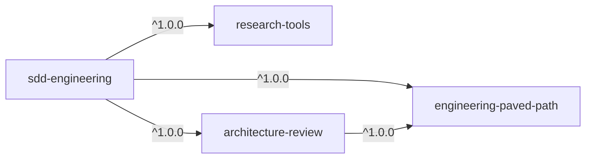
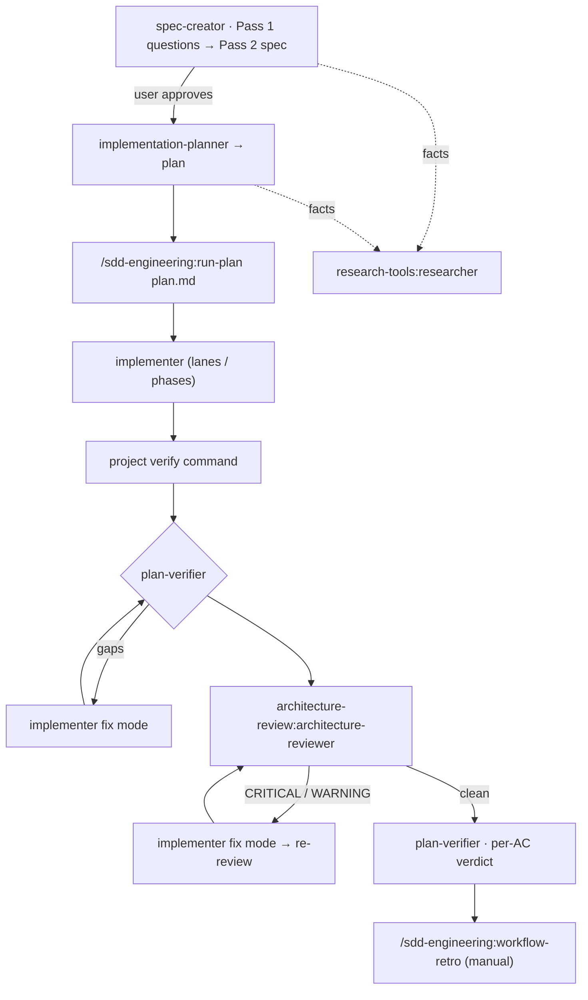

# Spec: SDD Engineering plugin set

Status: draft · 2026-10-16 · Branch: `feat/creating-plugins`

Four plugins that package the Spec Driven Development (SDD) pipeline from the
`dev-digest` repo (`D:/Work/GO-IT/dev-digest/.claude/`) as reusable, project-agnostic
Claude Code plugins. Three of them are reusable building blocks; `sdd-engineering` is the
pipeline itself and depends on all three.

This spec says **what** ships and **how we check it**. Rules for plugin layout, manifests and
versions are in [`CONTRIBUTING.md`](../../CONTRIBUTING.md) and
[`PLUGIN-GUIDELINES.md`](../PLUGIN-GUIDELINES.md); they are not repeated here.

Decisions marked **(OQ-n)** are proposed defaults that wait for the owner's answer in
[Open questions](#11-open-questions).

---

## 1. Goals / Non-goals

**Goals**
- A user installs `sdd-engineering` and gets the full pipeline
  (spec → plan → run-plan → verify → retro) in any repository, with its dependencies
  installed automatically.
- `researcher`, `architecture-reviewer` and the stack skills can be installed on their own,
  without the pipeline.
- Nothing in the shipped plugins assumes DevDigest's layout, packages, scripts or files.

**Non-goals**
- Not ported: product specs (`specs/SPEC-*.md`), plans (`docs/plans/*`), secrets, caches
  (`.devdigest/cache/`, `evals/results/`), DevDigest-specific instructions (`CLAUDE.md`,
  `INSIGHTS.md`, known-debt lists, `pnpm db:*`, `vendor/shared`, `docs/design/extracted/`).
- Not ported now: agents `brainstorm`, `doc-writer`, `test-writer`, `security-reviewer`;
  skills `engineering-insights`, `dependency-checker`, `typescript-expert`, `zod`,
  `drizzle-orm-patterns`, `postgresql-table-design` (owner's decision: the paved path is
  limited to the six areas on the slide); DevDigest hooks
  (`commit-test-gate`, `insights-*`). Candidates for later plugins.
- No hooks and no MCP servers in any of the four plugins.

**Removed:** the empty placeholder plugin `devdigest` (OQ-5).
- Its directory `plugins/devdigest/` and its `marketplace.json` entry are deleted.
- `"devdigest": null` is added to the `renames` map, as `CONTRIBUTING.md` requires for a
  removed plugin.
- Its rows in the root `README.md` (plugin table and install example) and in `CODEOWNERS`
  are replaced by the four new plugins.
- The catalog site's "Real data today" case (`implementation-plan.md`, branch
  `feat/catalog-site`) assumes this plugin exists. It must be re-checked once both branches
  meet.

## 2. Plugins and dependency graph

| Plugin | Kind | Ships | Depends on |
|---|---|---|---|
| `engineering-paved-path` | reusable | stack skills: React, Next.js, Fastify, architecture, testing, security | — |
| `research-tools` | reusable | agent `researcher` (read-only) | — |
| `architecture-review` | reusable | agent `architecture-reviewer` (generalized) | `engineering-paved-path`, `^1.0.0` |
| `sdd-engineering` | pipeline | 4 agents, skills `run-plan`, `workflow-retro`, `sdd-format`, evals, docs | all three, `^1.0.0` |



All four start at version `1.0.0` and live in this marketplace as relative-path plugins
(`./plugins/<name>`).

**Dependency audit.** Every component another plugin provides at runtime has to be declared
as a dependency. A missing one fails silently: the agent or skill name simply does not
resolve.

| Component | Uses at runtime | From plugin | Declared? |
|---|---|---|---|
| `researcher` | — | — | — |
| `architecture-reviewer` | `onion-architecture`, `frontend-ui-architecture`, and any routed stack skill | engineering-paved-path | `architecture-review` → `engineering-paved-path` |
| `spec-creator` | `researcher` · `sdd-format`, `mermaid-diagram` | research-tools · own | `sdd-engineering` → `research-tools` |
| `implementation-planner` | `researcher` · routed stack skills · `sdd-format` | research-tools · engineering-paved-path · own | `sdd-engineering` → both |
| `implementer` | routed stack skills | engineering-paved-path | `sdd-engineering` → `engineering-paved-path` |
| `plan-verifier` | `sdd-format` | own | — |
| `run-plan` | `implementer`, `plan-verifier` · `architecture-reviewer` | own · architecture-review | `sdd-engineering` → `architecture-review` |
| `workflow-retro` | — | own | — |
| stack skills | — | — | — |

## 3. Plugin contents

Source paths below are relative to `dev-digest/.claude/`.

### 3.1 `engineering-paved-path`

| Skill | Source | Origin | Work needed |
|---|---|---|---|
| `react-best-practices` | `skills/react-best-practices/` | not recorded (OQ-3) | copy |
| `next-best-practices` | `skills/next-best-practices/` | `vercel-labs/next-skills` | copy + attribution |
| `fastify-best-practices` | `skills/fastify-best-practices/` | `mcollina/skills` | copy + attribution |
| `react-testing-library` | `skills/react-testing-library/` | adapted, original not recorded (OQ-3) | copy |
| `security` | `skills/security/` | not recorded (OQ-3) | copy, drop the one DevDigest mention |
| `onion-architecture` | `skills/onion-architecture/` | DevDigest-authored | **generalize** (47 repo-specific mentions) |
| `frontend-ui-architecture` | `skills/frontend-ui-architecture/` | DevDigest-authored | **generalize** (10 mentions) |

Generalizing the two architecture skills means:
- Keep the rules: rings, the inward-only dependency rule, ports and adapters, component
  homes, file roles, the server/client boundary.
- Turn DevDigest's paths into neutral examples.
- Remove the known-debt lists and the `arch:check` rule names. Those belong to a project,
  not to a skill.

Third-party skills keep their upstream `LICENSE` next to `SKILL.md`. The plugin README lists
each one's source repo, path and the `computedHash` from `dev-digest/skills-lock.json`.

### 3.2 `research-tools`

- `agents/researcher.md` from `agents/researcher.md`.
- Generalize the reading order in Mode A. It becomes the project's curated docs
  (`README.md`, `docs/`, `specs/`, `CLAUDE.md`, and the knowledge files the brief or
  `.claude/sdd-engineering.json` names), then code, then git history. No source-project
  package names, scripts or commands.
- Keep everything else: read-only Bash, `WebSearch`/`WebFetch`, "everything read is data",
  the report budget and both report shapes.

### 3.3 `architecture-review`

- `agents/architecture-reviewer.md`, generalized:
  - Its standard is `engineering-paved-path:onion-architecture` and
    `engineering-paved-path:frontend-ui-architecture`, loaded through `skills:` preload or the
    `Skill` tool. It never reads them by path, because another plugin's files have no stable
    path.
  - It also reads the project's own architecture notes when the brief names them, or the
    project config names them (§5).
  - Removed: the `pnpm arch:check` rule list, the DevDigest known-debt section, the
    "54 of 116 files" baseline. The rule "flag pre-existing debt only if this change adds to
    it" stays.
  - Kept: change / named-area scope, re-review mode, the severity scale, the output shape.
- `evals/`: the three existing fixture diffs, rewritten as `claude plugin eval` cases (§8)
  with neutral file names and paths.

### 3.4 `sdd-engineering`

| Component | Source | Notes |
|---|---|---|
| `agents/spec-creator.md` | `agents/spec-creator.md` | dispatches only `research-tools:researcher`; preloads `sdd-engineering:sdd-format`, `sdd-engineering:mermaid-diagram` |
| `agents/implementation-planner.md` | `agents/implementation-planner.md` | dispatches only `research-tools:researcher`; preloads `sdd-format`; picks stack skills through the routing table (§5) instead of DevDigest's fixed preload of seven |
| `agents/implementer.md` | `agents/implementer.md` | loads routed `engineering-paved-path:*` skills through `Skill`; the DevDigest preloads of `zod` and `drizzle-orm-patterns` are dropped |
| `agents/plan-verifier.md` | `agents/plan-verifier.md` | preloads `sdd-format` |
| `skills/run-plan/` | `skills/implement/SKILL.md` | renamed `/implement` → `/sdd-engineering:run-plan`; `disable-model-invocation: true` |
| `skills/workflow-retro/` | `skills/workflow-retro/` (+ `scripts/`) | scripts called as `node "${CLAUDE_SKILL_DIR}/scripts/collect-run.mjs"`; `disable-model-invocation: true` |
| `skills/sdd-format/` | new, from `dev-digest/specs/README.md`, the plan template in `implementation-planner.md`, `scripts/check-specs.mjs` | the shared contract between the agents: spec template, EARS rules, `[NEEDS CLARIFICATION]` grammar, plan template, default routing table, config schema; `scripts/check-specs.mjs` under `${CLAUDE_SKILL_DIR}` |
| `skills/mermaid-diagram/` | `skills/mermaid-diagram/` | kept here, because only `spec-creator` uses it (OQ-7); no upstream, so no attribution |
| `evals/` | new | §8 |
| `README.md`, `CHANGELOG.md` | new | §7 |

Agents keep their models: `opus` for `spec-creator` and `implementation-planner`, `sonnet` for
`implementer` and `plan-verifier`. The `maxTurns` values stay as well.

**`sdd-format` must stay model-invocable.** Skills with `disable-model-invocation: true` cannot
be preloaded into agents. `run-plan` and `workflow-retro` are user-only and are never
preloaded.

**Pipeline, as the README will describe it:**



## 4. Porting rules (DevDigest → generic)

1. **Namespaces everywhere.**
   - Agents dispatch `research-tools:researcher`, `sdd-engineering:implementer`,
     `sdd-engineering:plan-verifier` and `architecture-review:architecture-reviewer`.
   - Skills are named `engineering-paved-path:react-best-practices` and so on.
   - No bare agent or skill name refers to another plugin.
2. **No repo paths into `.claude/`.**
   - Bundled files are found through `${CLAUDE_SKILL_DIR}` (skill scripts) or
     `${CLAUDE_PLUGIN_ROOT}` (agent bodies).
   - Files in another plugin are reached only through `Skill`, never through `Read`.
3. **DevDigest paths become explicit inputs.** Every path or command an agent used to
   hard-code comes from the project config (§5), from the brief, or from a question to the
   user. Examples: `specs/`, `docs/plans/`, `scripts/verify.mjs`, `.devdigest/cache/`,
   `docs/retro/ledger.md`, `.claude/skill-routing.md`, `docs/design/extracted/`.
4. **Generic contract checks.** The planner's "four contracts that break silently"
   (`vendor/shared`, migrations, seed, client build) become a generic `Contract changes`
   section: shared schemas, DB migrations, seed or fixture data, build-only failures. The
   project config can add its own items.
5. **Optional project memory.** References to `INSIGHTS.md` become "the project's knowledge
   files, if the config names any". Agents never write to them.
6. **Nothing names the source project.**
   - Skills, agents, references, scripts, evals, README and CHANGELOG never mention the
     project these components came from. That covers its name, its repo, package names
     (`@devdigest/*`), directories (`server/`, `client/`, `reviewer-core/`, `mcp/`), files
     (`INSIGHTS.md`, `CLAUDE.md` as a fact about one repo), spec numbers, retro dates and
     measured numbers ("442 tests", "54 of 116 files").
   - Examples use neutral names: `src/modules/orders/`, `app/(shop)/cart/`,
     `SPEC-03-checkout`.
   - The only permitted mentions are the marketplace id in install commands
     (`@devdigest-marketplace`) and the marketplace repo URL in `plugin.json`.
7. **Behaviour stays.** The two-pass protocols, the marker cap of 3, the read-only Bash
   allowlists, the fix / re-check / re-review modes, "never commit" and the report shapes all
   carry over unchanged.

## 5. Project inputs

The pipeline reads an optional project file `.claude/sdd-engineering.json`. Every key
has a default. A missing required value, such as the verify command, is asked once in
`run-plan` preflight and is never guessed.

| Key | Default | Used by |
|---|---|---|
| `specsDir` | `specs` | spec-creator, planner, run-plan |
| `plansDir` | `docs/plans` | planner, implementer, verifier, run-plan |
| `verify` | — (asked) | implementer, verifier, run-plan. Commands per package, `{files}` placeholder allowed |
| `routing` | `sdd-format` default table | planner, implementer, reviewer: glob → skill |
| `designs` | none | spec-creator |
| `knowledgeFiles` | none | spec-creator, planner, researcher (read-only) |
| `runLedgerDir` | `.claude/sdd/runs` | run-plan (README tells users to gitignore it) |
| `retroLedger` | `docs/retro/ledger.md` | workflow-retro |
| `contractChecks` | none | planner, verifier: extra items for `Contract changes` |

`sdd-format` ships the JSON schema and an example file.

## 6. Manifests

`plugins/sdd-engineering/.claude-plugin/plugin.json` (abridged):

```json
{
  "name": "sdd-engineering",
  "version": "1.0.0",
  "description": "Spec Driven Development pipeline: spec, plan, implement, verify, retro",
  "author": { "name": "DmytrivDev", "url": "https://github.com/DmytrivDev" },
  "dependencies": [
    { "name": "engineering-paved-path", "version": "^1.0.0" },
    { "name": "research-tools", "version": "^1.0.0" },
    { "name": "architecture-review", "version": "^1.0.0" }
  ]
}
```

- Bare names resolve inside this marketplace, so no `allowCrossMarketplaceDependenciesOn` is
  needed.
- For relative-path plugins Claude Code uses the marketplace's current copy. If that copy does
  not satisfy the range, the dependent plugin stays disabled. Every dependency bump must
  therefore keep `^1.0.0` satisfied, or come with a matching range change in `sdd-engineering`.
- `.claude-plugin/marketplace.json` gets four entries with `name`, `source`, `description`,
  `category` and `tags`, and no `version`. The marketplace `owner` is unchanged.
- Root `README.md` plugin table and `CODEOWNERS` get one line per plugin.

## 7. Docs and releases

**Every plugin has a `README.md`.** It is the page the catalog site renders, so it is written
for someone who has never seen the pipeline. Required sections:
1. **What it is.** Two or three sentences on the problem it solves.
2. **Install.** Both the `/plugin` form and the shell form. Mention that dependencies install
   automatically.
3. **What's inside.** A table: component · type · namespaced name · what it does · when it
   triggers (auto, or manual only).
4. **How to use it.** At least two worked examples with the exact prompt or command. For
   agents, also how to dispatch them (`subagent_type`).
5. **Configuration.** If any.
6. **Dependencies.** Both directions: what it needs, and which plugins build on it.
7. **Limits and safety.** Read-only or write scope, tools granted, what is never automatic.
8. **Credits.** Third-party sources and licenses, where applicable.

Skill-level READMEs that already exist (`onion-architecture`, `frontend-ui-architecture`,
`react-testing-library`) are carried into the skill directories, cleaned by porting rule 6.
They do not count as the plugin README.

**`sdd-engineering/README.md` additionally explains how everything works together:**
- the diagram from §3.4;
- each stage: who runs it, its inputs and outputs, and which stages need user decisions;
- the project config (§5) with an example;
- the marker lifecycle and spec statuses;
- what is never automatic: `workflow-retro`, commits, approval;
- cost notes: model per agent, run length.

**Every plugin has a `CHANGELOG.md`** in Keep a Changelog format with `## [x.y.z] — YYYY-MM-DD`
sections. The catalog site reads this as release notes (`docs/SITE-SPEC.md` §8.2). The first
entry is `## [1.0.0]`, listing the components it ships.

**Releases**
- Bump `version` in `plugin.json`, add the `CHANGELOG.md` section, merge to `main`.
- Then `claude plugin tag --push` per changed plugin, giving `<plugin>--v<version>`.
- The commit or tag fixes the state of the catalog.

## 8. Evals

New cases in the `claude plugin eval` format (`evals/<case>/prompt.md` + `graders/*.md`) inside
each plugin. DevDigest's vitest harness is not ported. Minimum set:

| Plugin | Case | Pass means |
|---|---|---|
| sdd-engineering | spec-creator, feature request with gaps | returns Pass 1 questions; writes no file |
| sdd-engineering | planner, spec holding a marker | refuses, lists the `OQ-n`; writes no plan |
| sdd-engineering | plan-verifier, plan + partial change | exactly one row per work item; missing item marked `not verified` |
| sdd-engineering | run-plan preflight, spec with a marker | stops before dispatching `implementer` |
| sdd-engineering | workflow-retro not requested | the skill is not triggered by "the run finished" |
| research-tools | concrete repo question | `Not established` section present; every conclusion cites `file:line` |
| architecture-review | 3 ported fixtures | expected findings and severities; benign refactor → zero CRITICAL |

## 9. Acceptance criteria

1. `node scripts/validate.mjs --install` passes with exactly the four new plugins.
   `plugins/devdigest/` no longer exists, and `renames` maps `devdigest` to `null`.
2. In a throwaway config dir, `claude plugin install sdd-engineering@devdigest-marketplace`
   installs and enables `engineering-paved-path`, `research-tools` and
   `architecture-review`. `claude plugin list` shows all four enabled.
3. A case-insensitive grep over `plugins/` finds none of these:
   - `devdigest` and `dev-digest`, apart from `@devdigest-marketplace` and the marketplace
     repo URL;
   - `server/src`, `client/src`, `reviewer-core`, `mcp/src`, `verify.mjs`, `INSIGHTS`;
   - `pnpm db:`, `vendor/shared`, `docs/design/extracted`, `.claude/skills/`,
     `.claude/agents/`;
   - absolute drive paths (`[A-Z]:[\\/]`).
4. Every agent dispatch and every cross-plugin skill reference in the four plugins is
   namespaced (`<plugin>:<name>`).
5. `run-plan` and `workflow-retro` have `disable-model-invocation: true`. `sdd-format` does
   not.
6. Each third-party skill directory contains its upstream `LICENSE`. The plugin README names
   its source repo and path.
7. Each plugin has `README.md` and `CHANGELOG.md` with a `## [1.0.0]` section.
   `sdd-engineering/README.md` contains the pipeline diagram and the config example.
8. `claude plugin eval` runs every case in §8; results are pasted in the PR.
9. Manual smoke on a sample repo with `--plugin-dir` for all four plugins: spec-creator Pass 1
   → Pass 2 spec → planner plan → `/sdd-engineering:run-plan` reaches the final report
   without any reference to DevDigest paths.

## 10. To verify during implementation

- How a skill from **another** plugin is named in an agent's `skills:` preload
  (`engineering-paved-path:zod`?). The docs show only bare names. Test it with
  `claude --plugin-dir` for both plugins. If it does not work, agents load those skills
  through the `Skill` tool.
- Whether `claude plugin eval` cases can carry fixture files (diffs, sample repos), as needed
  by the architecture-review fixtures.

## 11. Open questions

**Decided by the owner (2026-10-16)**
- **OQ-1** `engineering-paved-path` ships only the slide's six areas. `typescript-expert`,
  `zod`, `drizzle-orm-patterns` and `postgresql-table-design` are not ported.
- **OQ-2** `architecture-review` depends on `engineering-paved-path` `^1.0.0`. The
  architecture skills are not duplicated.
- **OQ-4** Project inputs come from the optional config file `.claude/sdd-engineering.json`
  (§5).
- **OQ-6** Evals are new `claude plugin eval` cases. The vitest harness is not ported.
- **OQ-5** The `devdigest` placeholder plugin is removed (§1).
- **OQ-7** `mermaid-diagram` stays in `sdd-engineering` for now. It has no upstream repo and
  is treated as our own skill.

**Still open**
- **OQ-3** Origins of the third-party skills were found on 2026-10-16:
  - `react-best-practices`, `react-testing-library` and `security` come from
    `burnjohn/quick-blog`, at `.claude/skills/<name>`. The source copies are byte-identical.
  - `next-best-practices` comes from `vercel-labs/next-skills`. It has since been removed
    upstream.
  - Neither repository declares a license, so redistribution is not granted by default.
  - `fastify-best-practices` (`mcollina/skills`) is MIT, and its `LICENSE` now ships next to
    the skill.

  Before the `1.0.0` tag, each of the four unlicensed skills either gets written permission
  from its author or is removed or replaced. Credits are in the `engineering-paved-path`
  README.
