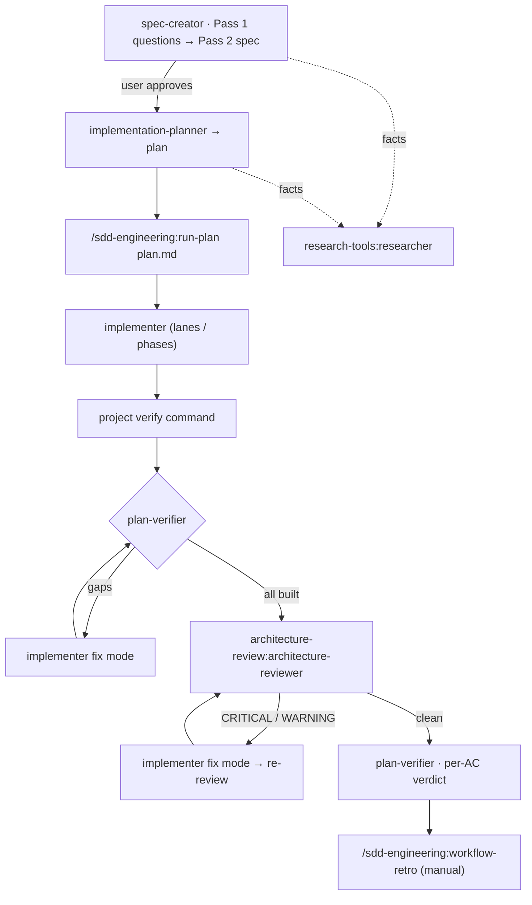
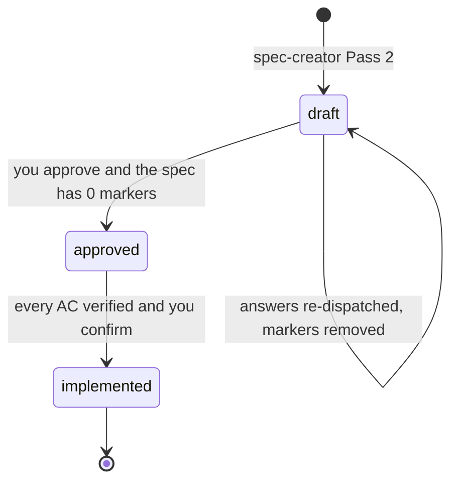
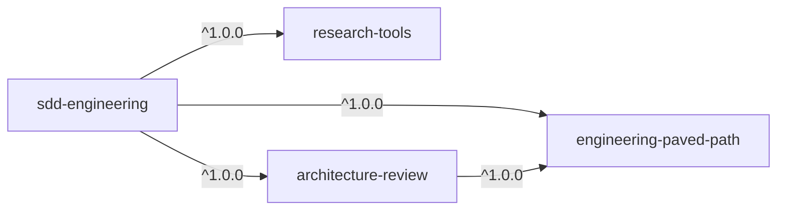

# sdd-engineering

A Spec Driven Development (SDD) pipeline for Claude Code. A feature goes from an idea to
reviewed, verified code in three hand-started stages: a **spec** with checkable acceptance
criteria, a **plan** that traces every criterion to a work item, and a **run** that implements
the plan, checks it item by item, reviews the architecture and fixes what the review finds.
Each stage is done by a dedicated agent with a narrow write scope, and every product decision
stays with you.

It works in any repository. Paths and commands come from an optional project config, and the
one thing it cannot guess, how to run your checks, it asks you once.

## Contents

- [Install](#install)
- [What's inside](#whats-inside)
- [How everything works together](#how-everything-works-together)
- [Quick start: one feature in five minutes](#quick-start-one-feature-in-five-minutes)
- [How to use it](#how-to-use-it)
- [Configuration](#configuration)
- [Dependencies](#dependencies)
- [Models and cost](#models-and-cost)
- [Limits and safety](#limits-and-safety)
- [Evals](#evals)
- [Credits](#credits)

## Install

In a Claude Code session:

```
/plugin marketplace add DmytrivDev/DevDigest-AI-Marketplace
/plugin install sdd-engineering@devdigest-marketplace
```

Or from a shell:

```bash
claude plugin marketplace add DmytrivDev/DevDigest-AI-Marketplace
claude plugin install sdd-engineering@devdigest-marketplace
```

Its three dependencies, `engineering-paved-path`, `research-tools` and
`architecture-review`, are installed and enabled automatically. Check with
`claude plugin list`.

## Compatibility

Claude Code `>=2.1.110` (version-constrained plugin `dependencies`); tested with `2.1.301`.
Details, and the features this plugin relies on: [`COMPATIBILITY.md`](COMPATIBILITY.md).

## What's inside

| Component | Type | Namespaced name | What it does | Triggers |
|---|---|---|---|---|
| `spec-creator` | agent (Opus) | `sdd-engineering:spec-creator` | Turns a feature request (plus designs and screenshots) into one spec with EARS acceptance criteria, edge cases, NFRs and a traceability matrix. Two passes: questions first, the file only after your answers. Also flips a spec to `approved` or `implemented` when you say so. | On request by name, or when Claude delegates spec writing; dispatched with `subagent_type` |
| `implementation-planner` | agent (Opus) | `sdd-engineering:implementation-planner` | Turns an approved spec (or a plain request) into one plan: affected files, the stack skills that govern each, contract changes, work items with `Done means`, execution lanes or phases, the verification plan. | On request by name, or when Claude delegates planning |
| `implementer` | agent (Sonnet) | `sdd-engineering:implementer` | Executes a plan, one lane or one phase of it, or a list of findings (fix mode). Loads the routed stack skills, writes code, runs the configured checks, reports per item. | Dispatched by `run-plan`; or by name |
| `plan-verifier` | agent (Sonnet) | `sdd-engineering:plan-verifier` | Read-only. Settles the working tree against the plan: exactly one verdict row per work item and one per requirement. | Dispatched by `run-plan`; or by name |
| `run-plan` | skill (command) | `/sdd-engineering:run-plan` | Orchestrates the implementation half: preflight → implement → integrate → verify ⟲ fix → review ⟲ fix → final verify → report. Never commits. | **Manual only** |
| `workflow-retro` | skill (command) | `/sdd-engineering:workflow-retro` | Retrospective of a finished multi-agent run: agents, order, tokens, what was hard, duplicated or lost, plus proposals. Appends one entry to the retro ledger. | **Manual only** |
| `engineering-insights` | skill | `/sdd-engineering:engineering-insights` | Captures durable, non-obvious learnings (gotchas, what worked, dead ends, conventions, recurring errors) into the knowledge file of the area the work touched: reads it first, dedups, appends through a script that cannot overwrite, rebuilds a line-numbered index. Main session only, never a subagent. | On request, at the end of substantial work, "wrap up", "save this learning" |
| `sdd-format` | skill (reference) | `sdd-engineering:sdd-format` | The shared contract: config keys, spec template, EARS rules, `[NEEDS CLARIFICATION]` grammar and checker, plan template, routing table, verification rules. | Preloaded into the four agents and loaded by `run-plan`; not shown in the `/` menu |
| `mermaid-diagram` | skill | `sdd-engineering:mermaid-diagram` | Mermaid diagram guide and templates (flows, states, sequences, ER). | Preloaded into `spec-creator`; auto when Claude needs a diagram |
| evals | `claude plugin eval` cases | — | Six guard-rail checks (two negative) and the fixed cost-baseline scenario. See [Evals](#evals). | Run by you |

The pipeline also dispatches two agents from its dependencies:
`research-tools:researcher` (facts from the code or the web, for the spec and the plan) and
`architecture-review:architecture-reviewer` (the review step of `run-plan`).

## How everything works together



Three stages, each started by you. The spec and the plan need your decisions; the run needs a
clean context, so start it in a new chat.

### The stages at a glance

| # | Stage | Who runs it | Input | Output | Your decision |
|---|---|---|---|---|---|
| 1 | Spec, Pass 1 | `spec-creator` | feature request, designs, screenshots, notes | questions with proposed defaults, design gaps, UX proposals; **no file** | answer each question, accept or decline each proposal |
| 1 | Spec, Pass 2 | `spec-creator` | Pass 1 report + your answers | `<specsDir>/SPEC-NN-<slug>.md`, `Status: draft`, index row | review the spec; unanswered points become markers |
| 1 | Approval | `spec-creator` | "the user approved `<spec>`" | `Status: approved` (refused while any marker remains) | **you approve**; nobody else can |
| 2 | Plan | `implementation-planner` | approved spec path + **execution mode** | `<plansDir>/<slug>.plan.md` | choose single-agent or multi-agent; read `Requirements traceability` and every `Done means` |
| 3 | Run | `/sdd-engineering:run-plan` | plan path, optional notes and design paths | changed files, a ledger, a final report with a per-requirement table | verify commands if not configured; triage asks; disputed findings; escalations |
| 4 | Ship | you | the diff and the report | commit, PR; then `spec-creator` marks the spec `implemented` | **you commit**; you confirm `implemented` |
| 5 | Retro (optional) | `/sdd-engineering:workflow-retro` | this conversation, or the session transcripts (`deep`) | chat summary + one ledger entry with proposals | **you start it**; you decide which proposals to apply |

### 1. Spec: `spec-creator`

Dispatch it with the request, any design files or screenshots, and notes. It reads the
project's docs, the config's `designs` and `knowledgeFiles`, existing specs and the code, and
sends `research-tools:researcher` for facts it cannot read itself.

- **Pass 1** returns `NO SPEC WRITTEN — needs input`: the feature as understood, a design
  review (gaps, uncovered corner cases, cross-module questions, untrusted inputs), questions
  each with a *proposed default*, and proposals to accept or decline. A default applies only
  if you accept it.
- **Pass 2** runs when you re-dispatch it with your answers. It writes the spec from the
  `sdd-format` template, adds the index row, self-checks the file on disk, and reports
  `SPEC WRITTEN` with the marker count.
- **Approval** is a third, tiny dispatch: tell it you approved the spec. It sets
  `Status: approved` only if the spec holds zero markers.

A spec says **what** is built and how we know it works: EARS acceptance criteria
(`WHEN …, the system shall …`), each with a `Verify:` hint, edge cases, NFRs, contracts at
service boundaries, provenance of inputs, a traceability matrix. **How** it is built is the
plan's job.

### 2. Plan: `implementation-planner`

Dispatch it with the spec path **and the execution mode you chose**. Then it finishes in one
pass: on a plannable spec it asks no requirements questions, because the spec already went
through them with you.

- **single-agent**: one implementer runs the work items in order, split into sequential
  phases if the plan is long. Cheaper and simplest to review.
- **multi-agent**: work items are grouped into lanes with disjoint files; lanes without
  dependencies run in parallel. Faster on a wide change, more tokens, one integration risk.

The plan lists the affected files and the stack skills that govern each (from the routing
table), contract changes (shared schemas, migrations, seed data, build-only failures, plus
your `contractChecks`), work items with checkable `Done means`, and a verification plan built
only from commands that exist. It refuses a spec that still holds a marker and lists every
`OQ-n`. Without a spec (a plain request), it first returns its own questions, then plans.

**Before you run it**, read the plan's `Requirements traceability` and every `Done means`:
that is what everything downstream is judged against.

### 3. Run: `/sdd-engineering:run-plan`

```
/sdd-engineering:run-plan docs/plans/<slug>.plan.md [notes…] [design or screenshot paths…]
```

The session becomes an orchestrator. It dispatches agents, runs the cheap checks itself,
keeps a ledger, and never writes production code or reviews anything itself.

| Step | What happens | Loops and limits |
|---|---|---|
| Preflight | Reads the config and the plan header; **stops if the plan's spec holds a `[NEEDS CLARIFICATION]` marker**; asks once for missing verify commands; warns on the default branch and offers `git switch -c feat/<slug>`; creates or resumes the ledger | a note that adds scope stops the run |
| Implement | one `sdd-engineering:implementer` per lane (parallel) or phase (sequential) | structural `BLOCKED` → back to you |
| Integrate | each touched package's `verify.full` command, plus extra checks only if the plan names them | red → fix mode, max 2 rounds |
| Verify #1 | `sdd-engineering:plan-verifier`: is every item built? | gaps → fix mode → re-check of the fixed items only, max 2 rounds |
| Review ⟲ fix | `architecture-review:architecture-reviewer` on the changed files (plus a security reviewer if your project has one installed) | CRITICAL / WARNING fixed by default, SUGGESTION listed, plan conflicts asked; re-review sees only the lines the fix changed; max 3 rounds |
| Verify #2 | final full checks + plan-verifier's per-item and **per-requirement** tables | — |
| Report | `DONE`, `DONE WITH OPEN ITEMS` or `STOPPED at <step>`, open items, skipped suggestions, ledger path | — |

**Triage.** Every finding gets an id `F<n>` and a decision in the ledger. The implementer may
answer a finding with `disputed` and evidence; you decide those. A finding that reopens after
a fix, or open findings after round 3, are escalated to you with options: another round,
accept as is, or change the plan.

**Resuming.** The ledger at `<runLedgerDir>/<slug>.md` (default `.claude/sdd/runs/`) records
every completed step. After a context reset, run the same command again and choose "resume".

### 4. Ship, then close the spec

`run-plan` never commits. Review the diff, follow your project's branching rules, commit and
open a PR. Then re-dispatch `spec-creator` with plan-verifier's per-requirement table and
your confirmation: it sets the spec to `implemented` only when every AC is verified.

### 5. Retro (optional): `/sdd-engineering:workflow-retro`

After a multi-agent run, in the same conversation, `/sdd-engineering:workflow-retro` reports
how many agents ran and in what order, token spend, what each agent found hard or easy, what
was duplicated, missed or lost, and at least one proposal (or "none" with the reason).
`/sdd-engineering:workflow-retro deep` also parses the session transcripts: nested agents,
fresh vs cached tokens, files read by several agents, results that never reached their
caller. One entry is appended to the retro ledger (default `docs/retro/ledger.md`) through a
script that refuses to change existing content. It proposes; it never edits an agent, skill,
spec or plan.

### Spec statuses and the marker lifecycle



- **`draft`**: editable. Any marker keeps a spec here.
- **`approved`**: never edited in substance again. A changed decision is a **new** spec with
  `Supersedes: SPEC-NN`; the old spec gains only a `Superseded by:` line.
- **`implemented`**: set by `spec-creator` from plan-verifier's per-requirement table and
  your confirmation.

**Markers.** A point you did not decide is never filled in silently. `spec-creator` writes it
inline where the assumption would have gone:

```text
[NEEDS CLARIFICATION: OQ-1 — round the discounted total to two decimals, or whole units?]
```

| Rule | Detail |
|---|---|
| Mirror | each marker has a line under `## Open questions`: `OQ-1 → AC-3 — …` |
| Cap | at most 3 per spec; more and no file is written, back to Pass 1 |
| Status | any marker keeps the spec `draft`; approval is refused |
| Planner | refuses the whole spec and lists every `OQ-n` with `file:line` |
| `run-plan` | stops in preflight if the plan's spec holds one |
| Checker | `skills/sdd-format/scripts/check-specs.mjs --dir <specsDir>` (bundled; `run-plan` runs it in preflight) fails on a marker in an `approved` or `implemented` spec, an unmirrored or id-less marker, more than 3 markers, or a missing `Status:` |

To clear a marker: answer the question, re-dispatch `spec-creator` with the answer, then
approve. A question you explicitly defer, and that blocks no criterion, is a plain open
question: no marker, no block.

To run the checker in CI, copy `skills/sdd-format/scripts/check-specs.mjs` from this plugin
into your repo; it has no dependencies.

### What is never automatic

- **Commits, pushes and PRs.** No agent and no skill in this plugin commits. Creating a
  branch happens only after you say yes.
- **Approval.** Only you approve a spec, and only you confirm `implemented`.
- **Product decisions.** Every proposed default needs your explicit yes; an unanswered
  question becomes a marker.
- **`/sdd-engineering:run-plan` and `/sdd-engineering:workflow-retro`.** Both are
  `disable-model-invocation: true`: Claude cannot start them, only you can.
- **Saving config.** `run-plan` writes the `verify` key into `.claude/sdd-engineering.json`
  only if you agree.

## Quick start: one feature in five minutes

The sample feature is "shoppers can apply a coupon at checkout".

**0. Optional: tell the pipeline how to check your code.** Create
`.claude/sdd-engineering.json`:

```json
{
  "verify": [
    { "package": "app", "dir": ".", "files": "npx vitest related --run {files}", "full": "npm run typecheck && npm test" }
  ]
}
```

Skip it and `run-plan` asks you once. Add `.claude/sdd/runs/` to `.gitignore`.

**1. Ask for a spec.**

```
Use the sdd-engineering:spec-creator agent to write a spec for: shoppers can apply a
discount coupon at checkout. Design: docs/design/checkout.png
```

You get `NO SPEC WRITTEN — needs input` with questions such as "percentage or fixed
amount? (proposed default: percentage)", "can coupons be combined? (proposed default: no)".

**2. Answer.**

```
Re-dispatch spec-creator with my answers: percentage only; one coupon per cart; codes are
case-insensitive; expired codes show "This code has expired". Accept proposals 1 and 3,
decline 2.
```

You get `SPEC WRITTEN — specs/SPEC-01-checkout-coupons.md`, `Status: draft`, `Markers: 0`.
Read it.

**3. Approve.**

```
Re-dispatch spec-creator: the user approved specs/SPEC-01-checkout-coupons.md.
```

**4. Plan.**

```
Use sdd-engineering:implementation-planner on specs/SPEC-01-checkout-coupons.md.
Execution mode: single-agent (my choice).
```

You get `PLAN WRITTEN — docs/plans/checkout-coupons.plan.md`. Read its traceability table and
the `Done means` lines.

**5. Run it, in a new chat.**

```
/sdd-engineering:run-plan docs/plans/checkout-coupons.plan.md
```

Answer what it asks (verify commands if you skipped step 0, the branch, triage). You end with
a report like `DONE — 4/4 items, 5/5 ACs verified · review: 1 round, 2 fixed`.

**6. Ship and close.** Review the diff, commit, open a PR. Then:

```
Dispatch spec-creator with this per-requirement table; the user confirms: mark
specs/SPEC-01-checkout-coupons.md implemented.
```

**7. Optional retro**, still in the run's chat:

```
/sdd-engineering:workflow-retro
```

## How to use it

### Dispatch an agent

Ask in plain language and name the agent, or dispatch it from another agent or a script with
`subagent_type`:

| Agent | `subagent_type` | Minimum brief |
|---|---|---|
| spec-creator | `sdd-engineering:spec-creator` | the feature request (+ design paths); for Pass 2, the Pass 1 report and your answers |
| implementation-planner | `sdd-engineering:implementation-planner` | the spec path + the execution mode you chose |
| implementer | `sdd-engineering:implementer` | the plan path (+ lane or phase id; or a findings list for fix mode) |
| plan-verifier | `sdd-engineering:plan-verifier` | the plan path (+ item ids and the previous table for re-check mode) |

Agents never talk to you directly. Their questions come back in their final report, and the
main session relays them.

### Example: plan from a request, without a spec

```
Use sdd-engineering:implementation-planner to plan this: "add a CSV export button to the
orders table, admins only". Execution mode: single-agent.
```

There is no spec, so the planner takes its two-pass route: it returns
`NO PLAN WRITTEN — needs input` with the requirements as understood, questions with defaults,
and recommendations. Re-dispatch it with your answers and it writes the plan, recording your
answers in its `Clarifications and recommendations` section.

### Example: check a branch against its plan

```
Use sdd-engineering:plan-verifier on docs/plans/checkout-coupons.plan.md. The change is on
the current branch, uncommitted.
```

It enumerates every work item and its `Done means` before reading any code, then settles each
one with evidence. You get one row per item (`verified`, `partially verified`,
`not verified` or `unverifiable`), one row per acceptance criterion, plan items with no
change, and changes no item asked for.

### Example: run with notes and designs

```
/sdd-engineering:run-plan docs/plans/checkout-coupons.plan.md reuse the existing Drawer component docs/design/coupon-field.png
```

The image becomes a design passed to lanes that touch UI code; "reuse the existing Drawer
component" constrains *how* and is passed on. A note that adds behaviour the plan does not
have stops the run: re-plan or drop the note.

### Example: a deep retro

```
/sdd-engineering:workflow-retro deep --since 2026-10-16T09:00:00Z
```

### Example: keep a lesson for the next session

```
/sdd-engineering:engineering-insights the coupon import: allSettled in chunks, not Promise.all
```

It picks the knowledge file whose area the work touched (from `knowledgeFiles`), reads it,
skips what is already recorded, and appends at most five dated, `file:line`-grounded entries
under fixed sections. With no `knowledgeFiles` configured, it proposes `docs/knowledge.md`
and creates it only after you agree.

## Configuration

Everything is optional. The pipeline reads **`.claude/sdd-engineering.json`** in the project
root; a missing file or key means the default. The full format is in the
`sdd-engineering:sdd-format` skill (§1).

```json
{
  "specsDir": "specs",
  "plansDir": "docs/plans",
  "verify": [
    {
      "package": "web",
      "dir": "apps/web",
      "files": "npx vitest related --run {files}",
      "full": "npm run typecheck && npm test && npm run build"
    },
    {
      "package": "api",
      "dir": "services/api",
      "files": "npx vitest related --run {files}",
      "full": "npm run typecheck && npm test"
    }
  ],
  "routing": "docs/sdd-routing.md",
  "designs": ["docs/design/", "docs/screenshots/"],
  "knowledgeFiles": ["docs/gotchas.md"],
  "runLedgerDir": ".claude/sdd/runs",
  "retroLedger": "docs/retro/ledger.md",
  "contractChecks": [
    { "name": "Shared types", "question": "Does a type shared by web and api change?", "check": "npm run check:shared" }
  ]
}
```

| Key | Default | Used by | Meaning |
|---|---|---|---|
| `specsDir` | `specs` | spec-creator, planner, run-plan | where specs and their `README.md` index live |
| `plansDir` | `docs/plans` | planner, implementer, plan-verifier, run-plan | where plans live |
| `verify` | none: **asked once, never guessed** | implementer, plan-verifier, run-plan | per package: `dir`, a targeted command with `{files}`, a `full` command |
| `routing` | the `sdd-format` §5 table | planner, implementer, reviewer | a project file with its own glob → skill table, same columns |
| `designs` | none | spec-creator, run-plan | design sources: mock files, exported artboards, screenshot folders |
| `knowledgeFiles` | none | spec-creator, planner, researcher, reviewer; written by engineering-insights | project gotchas and notes; read-only for every agent. `/sdd-engineering:engineering-insights` is the only writer, append-only, from the main session |
| `runLedgerDir` | `.claude/sdd/runs` | run-plan | run ledgers; **add it to `.gitignore`** |
| `retroLedger` | `docs/retro/ledger.md` | workflow-retro | append-only retro log; usually committed |
| `contractChecks` | none | planner, plan-verifier | extra items for the plan's `Contract changes` section |

**`verify` in practice.** `files` runs once per work item after its last edit, with the
touched files substituted for `{files}` (relative to `dir`). `full` runs once per touched
package at integration and once at the end. A package with no entry is reported as
`not run — no verify command configured`, never as passed.

**Routing.** The default table maps common TypeScript layouts to the
`engineering-paved-path:*` skills: server modules to `onion-architecture`, UI trees to
`frontend-ui-architecture`, routes, auth, config, env files and CI workflows to `security`,
and so on. Rows that do not match your project cost nothing. A file no row matches is named
as a coverage gap, never treated as reviewed.

## Dependencies



| Plugin | Range | What this pipeline uses from it |
|---|---|---|
| `engineering-paved-path` | `^1.0.0` | the stack skills the routing table assigns: `onion-architecture`, `frontend-ui-architecture`, `security`, `fastify-best-practices`, `next-best-practices`, `react-best-practices`, `react-testing-library`. The planner names them per file, the implementer loads them before editing. |
| `research-tools` | `^1.0.0` | `research-tools:researcher`, the only agent `spec-creator` and `implementation-planner` may dispatch: read-only facts with `file:line` or dated sources, and an explicit `Not established` list |
| `architecture-review` | `^1.0.0` | `architecture-review:architecture-reviewer`, the review and re-review steps of `run-plan` |

All three install automatically with this plugin and can also be used on their own. No other
plugin in the marketplace depends on `sdd-engineering`.

## Models and cost

| Agent | Model | Max turns | Why |
|---|---|---|---|
| `spec-creator` | Opus | 50 | product and design judgement, runs once per feature |
| `implementation-planner` | Opus | 50 | technical design, runs once per feature |
| `implementer` | Sonnet | — | follows a written plan; the bulk of the tokens |
| `plan-verifier` | Sonnet | 40 | conformance against written `Done means`, strict evidence rules |
| `architecture-review:architecture-reviewer` | Sonnet | — | rule-checking against two skills, re-run every fix round |
| `research-tools:researcher` | Sonnet | — | bounded fact-finding with a report budget |
| `run-plan` orchestrator | your session's model | — | dispatches and triages; reads no source to judge it |

**Run length matters more than mode.** An agent's cost is roughly *tool calls × context*,
and context only grows, so one long run costs far more than several short ones. That is why:

- plans group work into runs of **one package and 3–5 items**, in either mode;
- checks are targeted, once per work item, and the full suite runs only at integration and at
  the end;
- `run-plan` passes paths, never the plan text or whole reports, and re-checks or re-reviews
  only what a fix touched;
- the review loop stops at 3 rounds and verification loops at 2.

Multi-agent mode buys wall-clock time on a wide change, not lower cost. To see where the
tokens went, run `/sdd-engineering:workflow-retro deep` and compare agents by *fresh* tokens;
totals are dominated by cheap cache reads.

## Limits and safety

| Component | Tools | May write | Never |
|---|---|---|---|
| `spec-creator` | Read, Grep, Glob, Write, Edit, Agent, Skill | `<specsDir>/SPEC-NN-<slug>.md`; the `## Index` table of `<specsDir>/README.md`; an existing spec only as the lifecycle allows | source, plans, docs, knowledge files; dispatches only `research-tools:researcher` |
| `implementation-planner` | Read, Grep, Glob, Bash (read-only git history), Write, Agent, Skill | one new `<plansDir>/<slug>.plan.md` (no `Edit` at all) | specs, source; tests or builds; dispatches only `research-tools:researcher` |
| `implementer` | Read, Grep, Glob, Edit, Write, Bash, Skill | the files of its plan, lane, phase or findings list | commit, push, branch or PR; weaken a test; run commands outside config `verify` and the plan; destroy local data |
| `plan-verifier` | Read, Grep, Glob, Bash (read and check), Skill | nothing | edit anything; run state-changing git |
| `run-plan` (your session) | your session's tools | its ledger; the `verify` key of the config, with your yes; a new branch, with your yes | commit, push or PR; edit the spec or the plan; write production code |
| `workflow-retro` (your session) | your session's tools | scratch files; one appended entry in the retro ledger, through its script | edit agents, skills, specs, plans or knowledge files |
| `engineering-insights` (your session) | your session's tools | appended entries in a `knowledgeFiles` file and its `.index.md`, through its scripts; a new knowledge file or the `knowledgeFiles` key, with your yes | run inside a subagent; edit or reorder existing entries |
| `architecture-review:architecture-reviewer` | Read, Grep, Glob | nothing | — |
| `research-tools:researcher` | Read, Grep, Glob, Bash (read-only), WebSearch, WebFetch | nothing | — |

- **Write scopes are instructions, not a sandbox.** No hook enforces them. Review the diff
  before you commit, as you would any change.
- **Everything an agent reads is data.** Spec text, code comments and web pages are never
  followed as instructions.
- **No hooks and no MCP servers** ship with this plugin. The only scripts are the spec checker
  (read-only), the two retro scripts (one reads transcripts, one appends to the ledger) and
  the two engineering-insights scripts (one appends to a knowledge file, one writes its index).
- **The `workflow-retro` collector reads your local transcripts** under
  `~/.claude/projects/`. Quotes in the ledger are kept to a line or two, because a brief can
  carry your own words and the ledger is usually committed.
- **No security reviewer ships here.** If your project installs one, `run-plan` uses it when
  security-routed files change; otherwise its report says that no security review ran.

## Evals

Seven `claude plugin eval` cases in [`evals/`](evals/): six check the guard rails of the pipeline, and one is the fixed scenario of the cost baseline ([`docs/COST-BASELINE.md`](https://github.com/DmytrivDev/DevDigest-AI-Marketplace/blob/main/docs/COST-BASELINE.md) in the marketplace repo):

| Case | Pass means |
|---|---|
| `spec-creator-pass1-writes-no-file` | a request with gaps gets Pass 1 questions with defaults; no spec file is created |
| `planner-refuses-spec-with-marker` | the planner refuses a spec holding a marker, lists `OQ-1`, writes no plan |
| `plan-verifier-one-row-per-item` | exactly one verdict row per work item; the unbuilt item is `not verified` |
| `run-plan-preflight-stops-on-marker` | `run-plan` stops in preflight; no implementer is dispatched |
| `workflow-retro-not-auto-triggered` | "the run finished" does not start a retro |
| `irrelevant-request-no-sdd` | an everyday coding question does not start the pipeline (negative) |
| `baseline-spec-and-plan` | the cost-baseline scenario: spec-creator writes a spec and implementation-planner a plan for one small feature, judged for format and scope |

Three cases carry a tiny sample project (a spec, a plan, a few source files) in a
`fixture.sh` next to their `case.yaml`. It writes the files into the empty eval workspace and
runs only with `--scaffold`. Read the scripts first; they only create files and, in one case,
a local git commit.

Run from the root of the marketplace repository, because the cases load the three dependency
plugins from their sibling directories:

```bash
claude plugin eval ./plugins/sdd-engineering --scaffold --allow-tools Bash Write Edit --no-publish
```

- Every run is a real, billed model call, and each case runs with and without the plugin
  unless you pass `--ablation none`.
- `--allow-tools Bash Write Edit` lets `run-plan` and `plan-verifier` run their checks, and
  makes the "writes no file" graders test the agents' own discipline rather than a missing
  permission.
- One case: `--case planner-refuses-spec-with-marker`. More confidence before a release:
  `--runs 3`. CI: add `--trust-plugin --json out.json` and pin `--model`.
- Results go to `evals/results/`, which is gitignored.

## Credits

- `mermaid-diagram` and every agent and skill in this plugin are original work, released with
  this marketplace.
- EARS (Easy Approach to Requirements Syntax): Mavin et al., IEEE RE'09.
- The `[NEEDS CLARIFICATION]` marker follows the GitHub Spec Kit convention, extended here with
  an `OQ-n` id.
